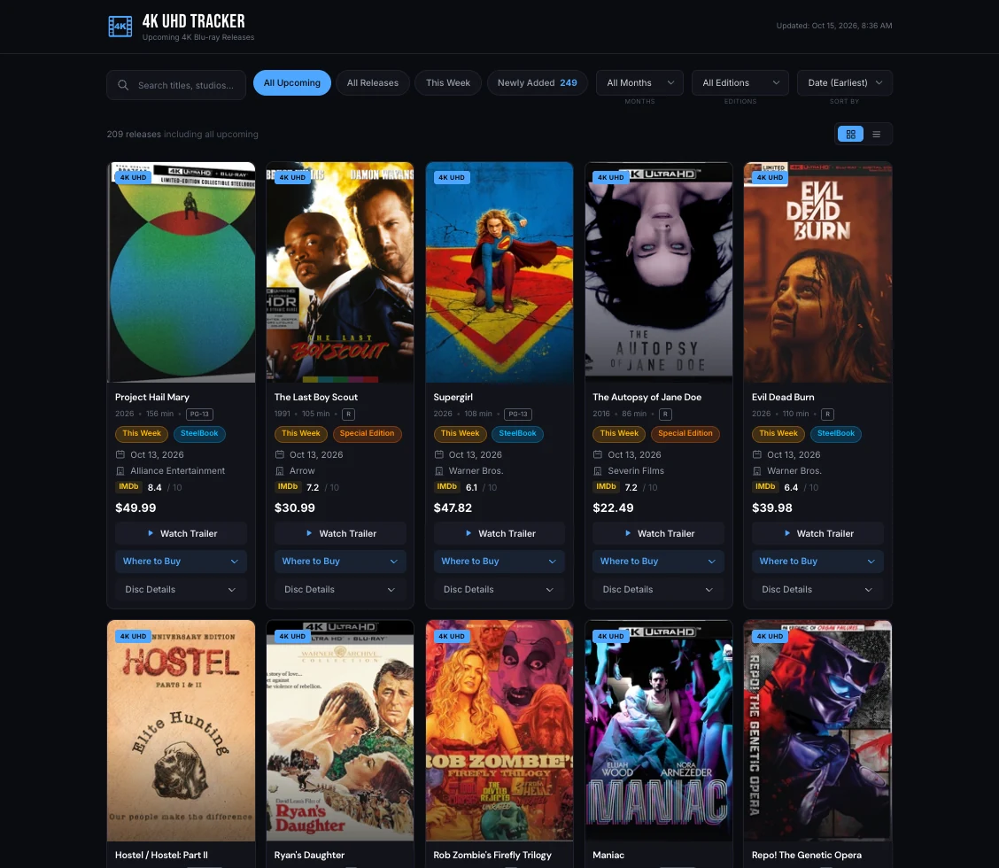
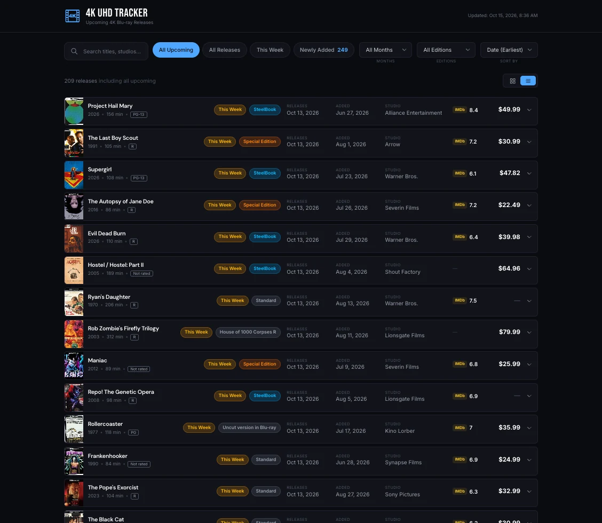

# 4K UHD Blu-ray Tracker

**Every upcoming 4K Blu-ray release in one place, updated every morning.**
Live at [4k.michaelkonieczki.com](https://4k.michaelkonieczki.com).

<p align="center">
  
</p>

## What it does

- **Upcoming releases at a glance**, as cover-art cards or a compact list, with release date,
  studio, edition (SteelBook, special editions and so on) and price.
- **Filters for what matters:** All upcoming, This week, Newly added (listed in the last 90 days, newest first),
  any month, any edition, plus search by title or studio.
- **Watch the trailer** without leaving the page.
- **Where to buy:** retailer links with prices.
- **Disc details:** video and audio specs, subtitles, discs in the set, packaging and region.

<p align="center">
  
</p>

## How it works

- **Next.js, React and Tailwind CSS**, written in TypeScript and hosted on Vercel.
- **A daily scrape.** A [GitHub Actions workflow](.github/workflows/scrape.yml) runs
  [`scripts/scrape.ts`](scripts/scrape.ts) every morning. It gathers the release listings and
  each disc's details, adds trailers from TMDB, and commits the result to
  [`public/releases.json`](public/releases.json) only when something changed. That commit
  redeploys the site.
- **No database or server to run.** The site is static: the page reads that one JSON file, and
  all the filtering, sorting and searching happens in the browser.
- **"This week" follows the calendar week** (Sunday to Saturday) rather than a rolling seven
  days, so a release doesn't drop out of the week halfway through it.

## Running it

```bash
npm install
npm run dev        # the site, at http://localhost:3000
npm run scrape     # refresh public/releases.json (trailers need a TMDB_API_KEY)
```

---

Built by Michael Konieczki ([michaelkonieczki.com](https://www.michaelkonieczki.com)).
This product uses the TMDB API but is not endorsed or certified by TMDB.
